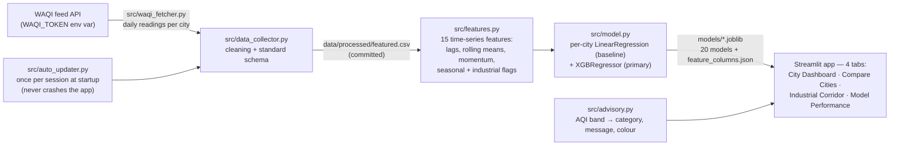

# Odisha Industrial AQI Analytics and Next-Day Health Advisor

Air-quality analytics and next-day AQI prediction for ten Odisha cities: daily WAQI readings through a feature pipeline into per-city Linear Regression and XGBoost models, served by a four-tab Streamlit dashboard with health advisories.


> This is an **analytics and learning project built from WAQI community sensor data** — not an
> official government forecast or a regulatory air-quality source. Official information comes from
> the Odisha State Pollution Control Board and CPCB.

## The problem

Odisha's industrial corridor (aluminium smelters, coal fields, steel plants) drives some of the
state's worst air, but public city-level views are scattered across generic AQI aggregators. This
project keeps a per-city daily AQI history for ten cities, engineers time-series features around
it, fits a model per city, and answers three questions in one dashboard: what is each city's AQI
now, how do industrial and urban cities compare, and how accurate is the next-day prediction.

## Architecture



## City coverage

Ten cities, defined with tiers and industry notes in `src/data_loader.py` (`CITIES`):

| City | Tier | Industry note (from code) |
|---|---|---|
| Jharsuguda | heavy industrial | Vedanta aluminium smelter, JSPL thermal power |
| Angul | heavy industrial | NALCO aluminium, NTPC Kaniha |
| Talcher | heavy industrial | Talcher coalfields, NTPC Talcher, coal transport dust |
| Rourkela | heavy industrial | SAIL steel plant, fertiliser and chemical industry |
| Sambalpur | heavy industrial | Cement plants, coal belt proximity, road dust |
| Bhubaneswar | urban | Traffic, construction activity, urban growth |
| Cuttack | urban | Dense traffic, old city road network, biomass burning |
| Balasore | urban | Port-adjacent industry, light manufacturing |
| Berhampur | clean baseline | Coastal city, sea breeze dispersion, light industry |
| Rayagada | clean baseline | Hilly terrain, bauxite mining, lower density |

Consistent with the tiers, the mean AQI in the committed `featured.csv` ranks the five
heavy-industrial cities highest (Talcher ≈ 246, Jharsuguda ≈ 236, Angul ≈ 228, Rourkela ≈ 214,
Sambalpur ≈ 205) and the two clean-baseline cities lowest (Berhampur ≈ 67, Rayagada ≈ 55).

## Measured results

From the committed [`data/processed/model_results.csv`](data/processed/model_results.csv)
(20 rows = 10 cities × 2 models):

| Metric | Range (per city/model) | Mean |
|---|---|---|
| R² (next-day AQI) | 0.860 – 0.946 | 0.916 |
| 3-category accuracy | 0.844 – 0.997 | 0.914 |
| MAE (AQI points) | 4.4 – 21.8 | 13.4 |

Linear Regression stays close to XGBoost on most cities (see the CSV for the per-city comparison);
the XGBoost advantage shows up on the harder industrial cities. Features are 15 time-series
variables (`models/feature_columns.json`): AQI lags and rolling windows, momentum and 3-day change,
pollutant lags (PM2.5, PM10, SO₂, NO₂), month, winter/monsoon/industrial-peak flags, and a
winter × industrial interaction.

## How to run locally

```cmd
python -m venv .venv
.venv\Scripts\pip install -r requirements.txt
.venv\Scripts\streamlit run app.py
```

That is enough to explore the dashboard — the processed data and all 20 trained models are
committed. Set a `WAQI_TOKEN` environment variable (free token from
<https://aqicn.org/data-platform/token/>) to let `auto_updater.py` refresh readings at startup;
without it the app runs on the committed data. To rebuild everything from raw readings, run the
notebooks in order (`notebooks/01`–`04`; not re-run in this documentation pass).

## Tests

`.venv\Scripts\python -m pytest -q` — verified 2026-10-06: **71 passed, 2 failed, 3 skipped**
(~84 s, hypothesis property tests included). The 2 failures are pre-existing and were not fixed
(code changes out of scope):

- `tests/test_data_collector.py::test_feature_labels_keys_match_feature_cols`
- `tests/test_features.py::test_rolling_7d_mean_correctness` (KeyError)

## Data sources

- **WAQI (World Air Quality Index) feed API** — <https://aqicn.org/api/> — daily AQI readings for
  the ten cities. Access is free with a token; per WAQI's own terms, **attribution to the World
  Air Quality Index project and the originating EPA is mandatory**, data may not be sold or
  redistributed as archived packages, and it is provided without warranty.
- No other data source is used.

## Limitations

- Predictions are next-day values learned from a single city-level daily AQI series — no
  satellite, meteorological or emissions data.
- Model quality varies by city (R² 0.86–0.95); the hardest cities are the industrial ones with
  the most variance.
- `auto_updater.py` appends to the committed `featured.csv` only at app runtime; the GitHub repo
  itself has no scheduled refresh.
- The Streamlit Community Cloud URL exists in the repo history but currently redirects to
  Streamlit's login wall, so no live link is included here.

## Deployment (Streamlit Community Cloud)

1. Entrypoint is `app.py` (imports from `src/`).
2. At <https://share.streamlit.io> → New app → repo, branch `main`, main file `app.py`.
3. Optional: add `WAQI_TOKEN` under Settings → Secrets so the auto-updater refreshes data.
4. Deploy.

## Project structure

```
odisha-aqi-advisor/
├── app.py                    # 4-tab Streamlit dashboard
├── src/
│   ├── constants.py          # AQI bands, tier labels, feature labels
│   ├── data_loader.py        # CITIES/tiers, CSV + model loaders
│   ├── waqi_fetcher.py       # WAQI API client (token via env)
│   ├── data_collector.py     # cleaning + standard schema
│   ├── features.py           # 15-feature engineering
│   ├── model.py              # LinearRegression + XGBRegressor training
│   ├── advisory.py           # AQI band → health advisory
│   ├── auto_updater.py       # session-start data refresh
│   └── visualisations.py     # Plotly charts
├── data/processed/           # featured.csv, model_results.csv, confusion matrices (committed)
├── models/                   # 20 .joblib models + feature_columns.json (committed)
├── notebooks/                # 01 cleaning → 02 features → 03 EDA → 04 modelling
└── tests/                    # pytest + hypothesis (76 tests; see Tests section)
```

## Licence

MIT — see [LICENSE](LICENSE).
